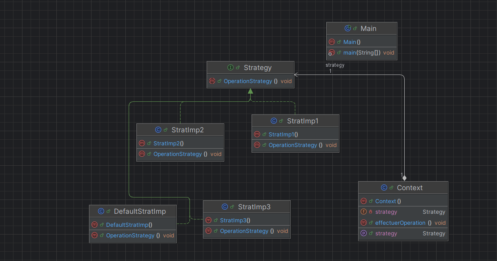
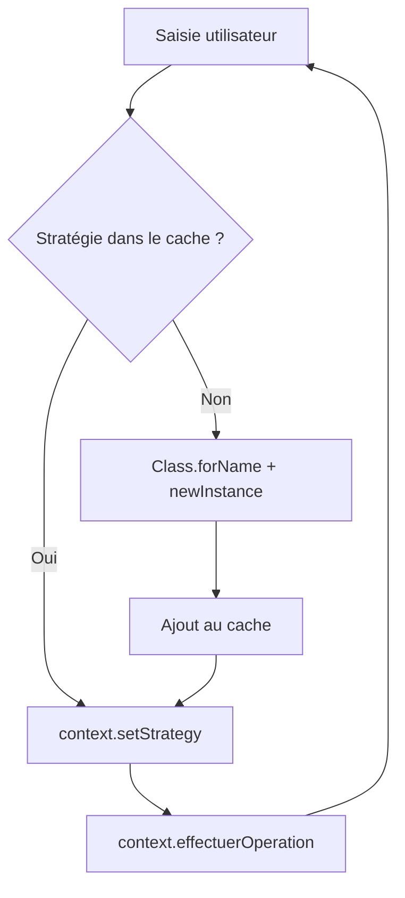
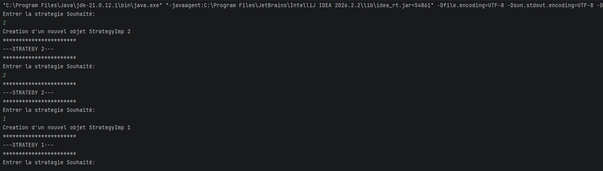

# StrategieDesignPattern

Implémentation en **Java 21** du design pattern **Strategy** (Stratégie), avec une sélection **dynamique** de la stratégie à l'exécution grâce à la réflexion Java.

---

## Table des matières

1. [Le pattern Strategy](#le-pattern-strategy)
2. [Structure du projet](#structure-du-projet)
4. [Architecture et diagramme de classes](#architecture-et-diagramme-de-classes)
5. [Description des classes](#description-des-classes)
6. [Fonctionnement du chargement dynamique](#fonctionnement-du-chargement-dynamique)
7. [Prérequis](#prérequis)
9. [Exemple d'exécution](#exemple-dexécution)
10. [Ajouter une nouvelle stratégie](#ajouter-une-nouvelle-stratégie)


---

## Le pattern Strategy

Le pattern **Strategy** est un pattern comportemental du « Gang of Four ». Il consiste à :

1. encapsuler chaque algorithme dans une classe distincte ;
2. faire implémenter à toutes ces classes une même interface ;
3. laisser un objet client (le *contexte*) déléguer son travail à l'interface, sans connaître l'implémentation concrète.

---

## Structure du projet

```
StrategieDesignPattern/
├── pom.xml
└── src/
    └── main/
        └── java/
            └── com/
                └── zouhari/
                    ├── Strategy.java          # Interface de la stratégie
                    ├── DefaultStratImp.java   # Stratégie par défaut
                    ├── StratImp1.java         # Stratégie concrète n°1
                    ├── StratImp2.java         # Stratégie concrète n°2
                    ├── StratImp3.java         # Stratégie concrète n°3
                    ├── Context.java           # Contexte utilisant une stratégie
                    └── Main.java              # Point d'entrée (interactif)
```

---

## Architecture et diagramme de classes



---

## Description des classes

### `Strategy` (interface)

Contrat commun à toutes les stratégies :

```java
public interface Strategy {
    void OperationStrategy();
}
```

### Implémentations concrètes

| Classe | Rôle | Sortie console |
|---|---|---|
| `DefaultStratImp` | Stratégie utilisée par défaut dans `Context` | `+++Default Strategy+++` |
| `StratImp1` | Stratégie n°1 | `---STRATEGY 1---` |
| `StratImp2` | Stratégie n°2 | `---STRATEGY 2---` |
| `StratImp3` | Stratégie n°3 | `---STRATEGY 3---` |


### `Main`

Point d'entrée interactif. Il boucle indéfiniment pour :

1. lire une saisie utilisateur (`Scanner`) ;
2. chercher la stratégie correspondante dans une `Map<String, Strategy>` (cache) ;
3. si elle n'existe pas encore, l'instancier dynamiquement ;
4. l'injecter dans le `Context` puis exécuter l'opération.

---

## Fonctionnement du chargement dynamique

Le nom de la classe est construit à partir de la saisie de l'utilisateur :

```java
Class.forName("com.zouhari.StratImp" + str)
     .getConstructor()
     .newInstance();
```

Ainsi, saisir `2` charge la classe `com.zouhari.StratImp2`. Les instances sont conservées dans une `HashMap` : une même stratégie n'est créée qu'**une seule fois** (le message *« Creation d'un nouvel objet StrategyImp … »* n'apparaît qu'à la première utilisation).


---

## Exemple d'exécution



On remarque que la seconde saisie de `1` ne recrée pas l'objet : il est récupéré dans le cache.

---

## Ajouter une nouvelle stratégie

Grâce au chargement dynamique, **aucune modification de `Main` ou `Context` n'est nécessaire** :

1. Créer une classe `StratImp4` dans le package `com.zouhari` :

   ```java
   package com.zouhari;

   public class StratImp4 implements Strategy {
       @Override
       public void OperationStrategy() {
           System.out.println("---STRATEGY 4---");
       }
   }
   ```

2. Recompiler, relancer, puis saisir `4`.

---

## Auteur

**Zouhari Dyae Errahmane** ---  [GitHub](https://github.com/zouharidyaeerrahmane)